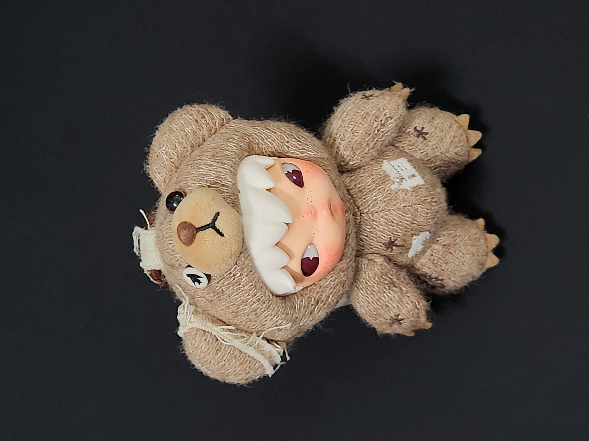
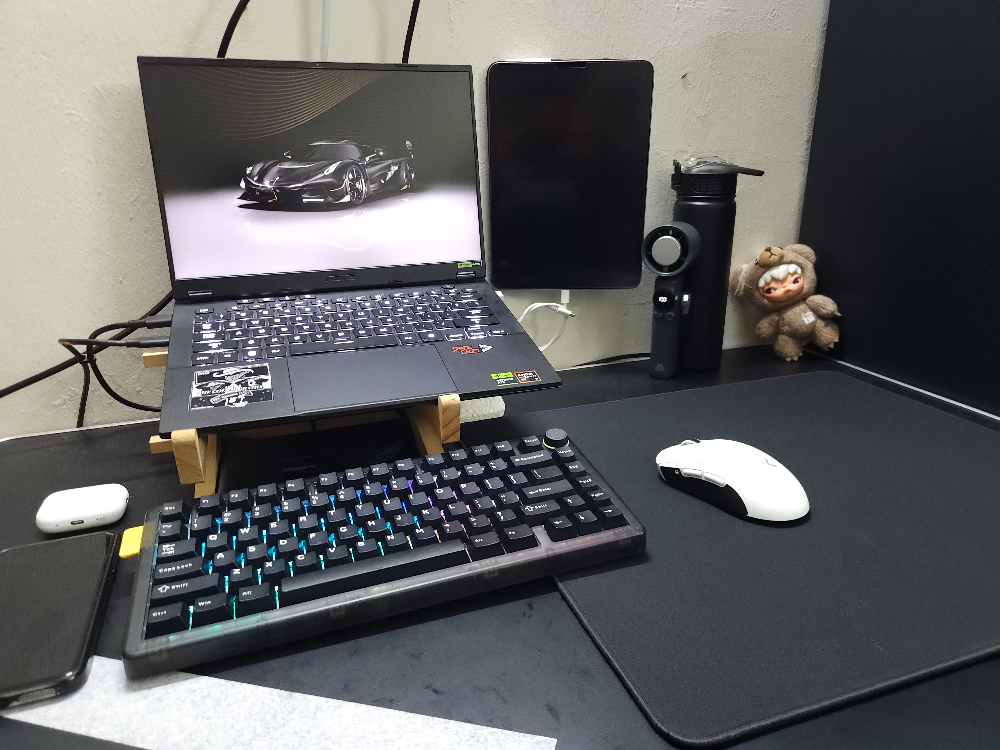
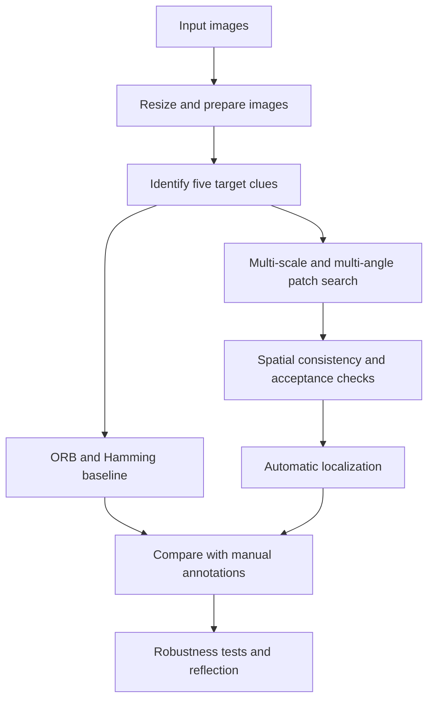
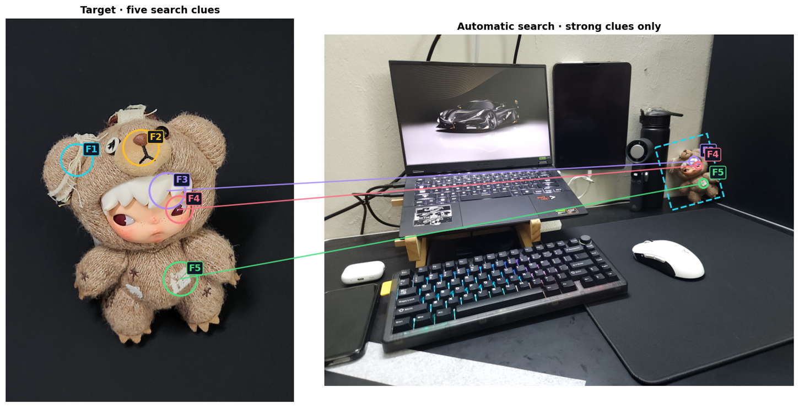

# 🔎 Digital Detective: Feature Extraction Challenge

> Classical computer vision | Locating a teddy-bear figurine in a cluttered scene


[](https://colab.research.google.com/github/AbidQayyumBaharuddin/Digital-Detective-Challenge-Feature-Extraction/blob/main/Digital_Detective_Abid_Qayyum.ipynb)

**[View the completed notebook](./Digital_Detective_Abid_Qayyum.ipynb)** · [Results](#results) · [How to run](#how-to-run)

## Project overview

The Digital Detective Challenge explores how a computer can locate a specific object in a complex photograph by identifying and comparing distinctive visual features. This project uses a close-up photograph of a teddy-bear figurine as the reference and a wide photograph of a cluttered desk as the search scene.

The experiment compares a conventional ORB/Hamming matching baseline with a scale- and rotation-aware local patch method. Human annotations are used separately as approximate ground truth, never to guide the automatic scene search.

## Objectives

- Identify and label five distinctive visual clues in the target image.
- Connect the corresponding features manually in the wide scene.
- Extract ORB keypoints and compare binary descriptors using Hamming distance.
- Locate the object automatically using multi-scale, multi-angle local patch matching.
- Evaluate feature reliability, localization error, and robustness to changes in orientation and lighting.

## Input images

| Close-up reference | Cluttered search scene |
| :---: | :---: |
|  |  |

## Methodology



The improved method searches the entire scene using normalized cross-correlation (`TM_CCOEFF_NORMED`). It evaluates nine scales (14–30%) and twelve angles (−20° to +35°), totaling 108 pose hypotheses. The three strongest local scores are averaged; acceptance also requires sufficient strong-feature support and separation from a competing location. A local score of at least 0.50 is classified as strong. These thresholds are heuristic, not calibrated probabilities.

## Results

### Automatic localization



*The cyan dashed outline indicates the estimated object extent. Three automatic correspondence lines are displayed; weak matches are deliberately omitted.*

| Metric | Saved result |
| :--- | ---: |
| Manual correspondences | 5/5 |
| Strong automatic clues | 3/5 |
| Combined similarity | 0.586 |
| Separation from competing location | 0.118 |
| Eye-anchor localization error | 3.0 px |
| ORB baseline: top 20 matches inside manual region | 0/20 |

### Feature reliability

| ID | Visual clue | Correlation | Assessment |
| :--- | :--- | ---: | :--- |
| F1 | Frayed ear strip | −0.012 | Weak |
| F2 | Bear nose / Y-shaped muzzle | 0.297 | Weak |
| F3 | Right pointed white fringe | 0.543 | Strong |
| F4 | Right burgundy eye | 0.571 | Strong |
| F5 | White chest patch | **0.644** | Strongest |

### Robustness experiments

| Condition | Similarity | Strong clues | Error (px) | Outcome |
| :--- | ---: | ---: | ---: | :--- |
| Original scene | 0.586 | 3/5 | 3.0 | Localized |
| Rotation (+15°) | 0.610 | 3/5 | 2.6 | Localized |
| Darker (×0.65) | 0.586 | 3/5 | 3.0 | Localized |
| Brighter (×1.15 + 20) | 0.574 | 3/5 | 3.6 | Localized |
| Figurine region removed | 0.468 | 1/5 | — | Correct rejection |

> Results are from the saved notebook experiment. Pixel errors are measured in the standardized 2048 × 1536 scene relative to approximate manual annotations. Correlations are similarity scores, not accuracy percentages. The ORB region check is a spatial proxy, not a direct test of correspondence identity.

## Repository structure

```text
 Digital-Detective-Challenge-Feature-Extraction/
 ├── README.md
 ├── Digital_Detective_Abid_Qayyum.ipynb
 ├── close-up_image.jpg
 ├── wide_image.jpg
 ├── matching_result.png
 ├── requirements.txt
 └── .gitignore
```

## How to run

### Option A — Google Colab (recommended)

1. Click the [Open in Colab](https://colab.research.google.com/github/AbidQayyumBaharuddin/Digital-Detective-Challenge-Feature-Extraction/blob/main/Digital_Detective_Abid_Qayyum.ipynb) badge at the top of this README.
2. Alternatively, open [Google Colab](https://colab.research.google.com/), select **File → Open notebook → Upload**, and choose `Digital_Detective_Abid_Qayyum.ipynb` downloaded from this repository.
3. In the Files sidebar, upload the original `close-up_image.jpg` and `wide_image.jpg` from the repository to the notebook's current working directory (normally `/content`).
4. Select **Runtime → Run all**. No GPU is required.
5. Verify the matching figures, manual correspondences and quantitative evaluation outputs.

### Option B — Local Jupyter Notebook

Download the repository using **Code → Download ZIP**, extract it, and open a terminal in the extracted folder. Install the dependencies and launch Jupyter:

```bash
python -m pip install -r requirements.txt
python -m notebook
```

Open `Digital_Detective_Abid_Qayyum.ipynb` and run the cells in order. The dependency list is a general setup rather than a fully locked environment; exact results may vary by library version. The saved run reported OpenCV 5.0.0.

### Reproducibility note

Use the original, unmodified image files from the final experiment. Do not upload a stale `wide_image(1).jpg`, as the notebook prioritizes that filename when present. Manual evaluation uses a SHA-256 fingerprint of the scene; the saved final reference expects:

```text
5add6578e8448ff2e6d7b44fbb1490855365be13143f3f7995eba3e74a4a68e2
```

If the file differs, the automatic search still runs, but reference-based evaluation and the negative-control test will be skipped until new manual annotations are registered.

## Reflection and limitations

The chest patch was the strongest clue, followed by the burgundy eye and white fringe. The ribbon and muzzle were more sensitive to scale, texture detail and viewpoint differences. Combining several spatially consistent features was more useful for this image pair than relying on the baseline ORB matches alone.

The positive results under synthetic rotation and lighting changes and the rejected negative control demonstrate robustness under the tested conditions. They do not establish performance on unseen photographs or extreme occlusion and perspective changes. Future work could incorporate additional target views and independent test scenes.

## Acknowledgements

Developed for the *Digital Detective: The Feature Extraction Challenge* coursework, following the assignment brief and the provided ORB reference lab. Built with Python, OpenCV, NumPy, Matplotlib and Jupyter.

- [OpenCV documentation](https://docs.opencv.org/)
- [Jupyter documentation](https://docs.jupyter.org/)

## Author

**Name:** MUHAMMAD ABID QAYYUM

**Course:** Computer Vision / Bachelor in Artificial Intelligence

**Project:** Digital Detective — The Feature Extraction Challenge

**GitHub:** [AbidQayyumBaharuddin](https://github.com/AbidQayyumBaharuddin)

This project was developed as part of an academic computer vision assignment to explore feature extraction, feature matching, object localization and robustness evaluation.